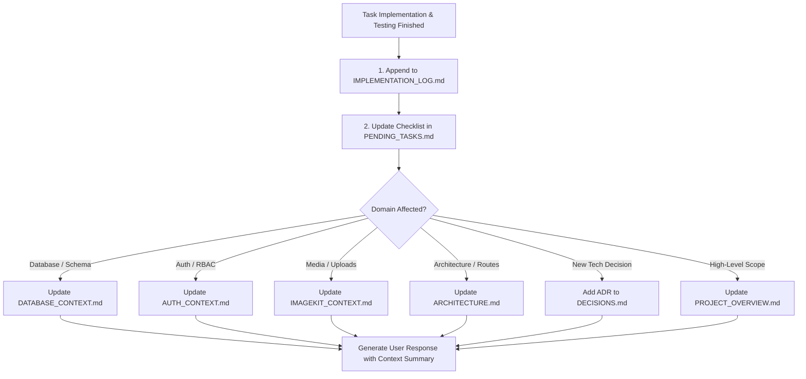

# Project Context Management Skill

This skill enforces standards for maintaining persistent AI development context, documentation, and continuity across AI models, sessions, and conversational context windows in the ScrubX project.

---

## 1. Core Principles

1. **Continuity Across Sessions:** AI agents frequently change, context windows get compacted, and developers start new chat sessions. The documentation inside `docs/ai-context/` is the **permanent memory** of the project.
2. **Dual-Source Verification:**
   - Documentation conveys architectural intent, schema design, and phase progress.
   - Source code, migrations, and database state represent the **ground truth**.
   - Always verify documented statements against actual code before acting.
3. **Atomic Documentation Updates:** Every implementation phase or prompt must conclude by updating the relevant context documents in `docs/ai-context/`.

---

## 2. Pre-Execution Protocol (Before Starting Any Task)

Whenever a new prompt, feature request, or bug fix is received, the agent **MUST** execute the following steps before writing or modifying code:

### Step 1: Read the Persistent Context
- Always inspect `docs/ai-context/PENDING_TASKS.md` to understand current progress and active phase boundaries.
- Read `docs/ai-context/ARCHITECTURE.md` to respect established directory and component responsibilities.
- Check `docs/ai-context/DECISIONS.md` to avoid re-litigating or contradicting previous architectural decisions (e.g. Supabase is Postgres-only, Better Auth handles auth, ImageKit handles media).
- Review domain-specific files if working on that domain:
  - Database tasks $\to$ `DATABASE_CONTEXT.md`
  - Authentication & session tasks $\to$ `AUTH_CONTEXT.md`
  - Media & image tasks $\to$ `IMAGEKIT_CONTEXT.md`

### Step 2: Codebase Reality Check
- **Never rely solely on chat memory or conversational summaries.** Previous conversations may have discussed planned features that were never actually committed to code.
- Check `package.json` for actually installed packages.
- Check actual file existence, export signatures, and TypeScript types.
- Check live database state or migration files before writing database queries.

### Step 3: Prevent Regressions & Duplicate Work
- Do not recreate files that already exist.
- Do not reinstall packages that are already present.
- Do not redesign or modify existing UI unless explicitly requested by the user.
- Maintain legacy mock data (`src/data/mock.ts` and `src/data/store.tsx`) until the relevant screen is fully wired to live database Server Actions.

---

## 3. Post-Execution Protocol (After Completing Any Task)

Immediately after implementing code changes, running tests, and verifying compilation, the agent **MUST** update the documentation in `docs/ai-context/`:



### Context Files & Update Triggers

| Context Document | When to Update |
|---|---|
| [`IMPLEMENTATION_LOG.md`](file:///home/rehan/Downloads/scrubX-admin/docs/ai-context/IMPLEMENTATION_LOG.md) | **Always.** Append a chronological log entry for every completed prompt/phase. |
| [`PENDING_TASKS.md`](file:///home/rehan/Downloads/scrubX-admin/docs/ai-context/PENDING_TASKS.md) | **Always.** Check off completed tasks, record new blockers, update phase statuses. |
| [`DATABASE_CONTEXT.md`](file:///home/rehan/Downloads/scrubX-admin/docs/ai-context/DATABASE_CONTEXT.md) | When tables, Drizzle schema, relations, migrations, pooler config, or triggers change. |
| [`AUTH_CONTEXT.md`](file:///home/rehan/Downloads/scrubX-admin/docs/ai-context/AUTH_CONTEXT.md) | When Better Auth config, RBAC tiers, route protection, login UI, or session rules change. |
| [`IMAGEKIT_CONTEXT.md`](file:///home/rehan/Downloads/scrubX-admin/docs/ai-context/IMAGEKIT_CONTEXT.md) | When ImageKit SDK, upload endpoints, transformation helpers, or asset lifecycles change. |
| [`ARCHITECTURE.md`](file:///home/rehan/Downloads/scrubX-admin/docs/ai-context/ARCHITECTURE.md) | When new directories, route trees, Server Component boundaries, or services are added. |
| [`DECISIONS.md`](file:///home/rehan/Downloads/scrubX-admin/docs/ai-context/DECISIONS.md) | When a new technical decision, architectural trade-off, or constraint is established. |
| [`PROJECT_OVERVIEW.md`](file:///home/rehan/Downloads/scrubX-admin/docs/ai-context/PROJECT_OVERVIEW.md) | When core business goals, high-level stack versions, or global restrictions change. |

---

## 4. Implementation Log Standards

Every entry appended to [`IMPLEMENTATION_LOG.md`](file:///home/rehan/Downloads/scrubX-admin/docs/ai-context/IMPLEMENTATION_LOG.md) must follow this exact Markdown format:

```markdown
## Phase/Task [Number]: [Title of Task]

### Objective
[1-2 sentence description of what the user requested and the goal of this phase]

### What Was Implemented
- [Bullet points of concrete code changes, architectural additions, and configurations]

### Files Created
- `path/to/new-file.ts`

### Files Modified
- `path/to/modified-file.ts` (brief description of change)

### Dependencies
- Installed: `package@version` (or "None")
- Removed: `package@version` (or "None")

### Key Technical Decisions
- [Decisions made during implementation, or reference to ADR in DECISIONS.md]

### Verification & Tests
1. [Test command executed]: [Result, e.g. "Clean (0 errors)"]
2. [Runtime/API test]: [Actual result, e.g. "Status 200 OK, session verified"]

### Known Issues & Minor Warnings
- [Any non-blocking warnings, temporary workarounds, or deprecation notices]

### Manual Configuration Required
- [Any environment variables or user dashboard actions required, or "None"]
```

---

## 5. Accuracy & Integrity Rules

1. **Zero Hallucination:** Never document a feature as "implemented" if it has only been planned or drafted. Explicitly label status as `Completed`, `Incomplete`, or `Planned`.
2. **Never Claim Untested Code Works:** If a build command or test was not executed, do not state that it passed. Run `npx tsc --noEmit` and relevant tests before claiming stability.
3. **Historical Log Immutability:** Never rewrite, delete, or re-order past log entries in `IMPLEMENTATION_LOG.md`. Always append new entries to the bottom of the log.
4. **Credential Security:** Never commit real secrets, API keys, database passwords, or JWT secrets to any documentation file. Always use placeholders (e.g. `[YOUR-PASSWORD]`, `******`).
5. **Targeted In-Place Editing:** Edit specific sections of existing documentation instead of deleting and recreating entire files.
6. **Code is King:** If code and documentation ever disagree, verify the code behavior, update the documentation to match reality, and notify the user.
7. **Documentation Freshness:** Any agent that completes a remediation phase or issue must keep the domain docs updated (`DATABASE_CONTEXT.md`, `AUTH_CONTEXT.md`, `IMAGEKIT_CONTEXT.md`, `ARCHITECTURE.md`). Documentation that contradicts source code is a defect, not intent. Never leave stale statements about decommissioned stores or planned features that are already implemented.

---

## 6. End-of-Turn User Handover Format

When concluding a turn after completing work, provide a structured summary so the user and any subsequent AI model immediately understand the updated state:

1. **Files Created / Modified:** Clear list of touchpoints.
2. **Key Capabilities Verified:** Test results, build checks, compilation status.
3. **Documentation Updated:** List of files modified in `docs/ai-context/`.
4. **Current Implementation Status:** What is working right now.
5. **Next Immediate Step:** The logical next phase or task to undertake.
