# ScrubX Admin — ImageKit Media Storage Context

> **Permanent AI Context Documentation**  
> *Last Updated: November 2026 (Phase 4 Completed)*

---

## 1. Current Integration Status: **IMPLEMENTED & ACTIVE**

> [!IMPORTANT]
> ImageKit is the **sole image storage and delivery provider** for ScrubX.
> - **Supabase Storage is strictly forbidden and not used.**
> - Permanent uploads are never written to the local filesystem.
> - Direct client-side uploads to ImageKit with server-generated ephemeral HMAC-SHA1 tokens are fully implemented.
> - Official Node.js SDK (`imagekit@^6.0.0`) handles server-side operations (auth signing, direct server uploads, deletions).
> - Responsive edge transformations, format optimization (`auto` format: WebP/AVIF), and quality presets are active.
> - End-to-end connection and live lifecycle (Upload $\to$ Transform $\to$ Delete) verified with 100% test pass rate.

---

## 2. Environment Configuration

The following credentials are configured in `.env.local` (placeholders in `.env.example`):

| Variable | Scope | Purpose | Example Value |
|---|---|---|---|
| `NEXT_PUBLIC_IMAGEKIT_PUBLIC_KEY` | Public / Browser | Client-side SDK / direct upload identification | `public_3yXyV1FQRta/uvhBcYSSoABG1ns=` |
| `IMAGEKIT_PRIVATE_KEY` | Server-Only | Signature generation & server-side API administration | `private_wkla+BQfYSEbIj5OXe536p6SchM=` |
| `NEXT_PUBLIC_IMAGEKIT_URL_ENDPOINT` | Public / Edge | CDN delivery endpoint for transformed URLs | `https://ik.imagekit.io/scrubxpk` |

Next.js is configured in `next.config.ts` to allow `ik.imagekit.io` in `remotePatterns`:

```typescript
// next.config.ts
images: {
  formats: ["image/avif", "image/webp"],
  remotePatterns: [
    {
      protocol: "https",
      hostname: "ik.imagekit.io",
      pathname: "/**",
    },
  ],
}
```

---

## 3. Storage Folder Organization & Security Rules

All uploaded media is organized into strict namespaces within ImageKit:

| Namespace Folder | Media Type | Security & Access | Database Reference |
|---|---|---|---|
| `/scrubx/products` | Catalog product photos & color variants | Public CDN delivery | `product_images.imagekit_file_id`, `product_images.url` |
| `/scrubx/categories` | Category card & banner imagery | Public CDN delivery | `product_categories.image_file_id`, `product_categories.image_url` |
| `/scrubx/engraving-logos` | Customer vector logos / embroidery artwork | Restricted / Private delivery | `order_item_engraving.logo_imagekit_file_id` |
| `/scrubx/payment-proofs` | Customer payment receipts (JazzCash, Bank slips) | Restricted / Private delivery | `payments.proof_image_file_id` |

---

## 4. Architecture & Data Flow

```mermaid
flowchart TD
    subgraph DirectBrowserUpload ["Direct Browser Upload Flow (Primary)"]
        UI["ImageUpload Component\n(src/components/shared/image-upload.tsx)"]
        AuthRoute["GET /api/upload/auth\n(src/app/api/upload/auth/route.ts)"]
        IK_API["https://upload.imagekit.io/api/v1/files/upload"]
        
        UI -->|"1. Request signature & token"| AuthRoute
        AuthRoute -->|"2. Return { token, expire, signature }"| UI
        UI -->|"3. POST multipart/form-data with XHR progress"| IK_API
        IK_API -->|"4. Return { fileId, url, thumbnailUrl, filePath }"| UI
        UI -->|"5. Update state & forms with { url, fileId }"| UI
    end

    subgraph ServerLifecycle ["Domain-Scoped Deletion & Post-Commit Purge Pipeline"]
        FormSave["Product / Category Form Mutation Commit"]
        DetachAction["detachProductImageAction({ productId, imageId })\n(src/actions/products.ts)"]
        DomainService["ProductService / CategoryService (Post-Commit Hook)"]
        SDK["ImageKit SDK Singleton\n(src/lib/imagekit.ts)"]
        IK_REST["https://api.imagekit.io/v1/files/{fileId}"]
        
        DetachAction -->|"1. Requires admin role, verifies ownership in DB"| DomainService
        FormSave -->|"1. DB transaction commits successfully"| DomainService
        DomainService -->|"2. safeDeleteImageKitFile(fileId) runs post-commit"| SDK
        SDK -->|"3. DELETE file"| IK_REST
    end

    subgraph EdgeCDN ["Edge CDN Transformations"]
        URLHelper["getImageKitUrl() / Presets\n(src/lib/imagekit-url.ts)"]
        CDN["ik.imagekit.io CDN Edge"]
        
        URLHelper -->|"Inject tr:w-...,h-...,q-...,f-auto"| CDN
    end
```



---

## 5. File Inventory & Responsibilities

### Server Infrastructure
1. **`src/lib/imagekit.ts`**:
   - Server-only boundary guard (`typeof window !== "undefined"` throws immediately).
   - Lazy singleton Proxy avoiding module evaluation race conditions during tests or builds.
   - Exports `getImageKitInstance()` and `imagekit` instance with full SDK methods (`upload`, `deleteFile`, `getAuthenticationParameters`).
2. **`src/app/api/upload/auth/route.ts`**:
   - Next.js dynamic Route Handler (`export const dynamic = "force-dynamic"`).
   - Protected with `requireStaffContext({ redirect: false })` to prevent anonymous signature farming.
   - Enforces rate limiting (30 signature requests / 10 min / user) and validates destination folders via `imageFolderSchema`.
   - Generates `{ token, expire, signature }` using official ImageKit SDK.
3. **`src/actions/media.ts`**:
   - `'use server'` Server Actions.
   - Arbitrary client `deleteMediaAction` removed (SEC-009). Domain deletions use `detachProductImageAction` or `ProductService` post-commit purging.
   - `uploadServerMediaAction(formData: FormData, folder)`: Staff/Admin server fallback for automated imports. Validates MIME type (raster only: JPEG, PNG, WebP, AVIF; SVG prohibited for XSS prevention per SEC-006), 5MB size limit, and binary magic bytes per SEC-007.

### Client Helpers & UI Components
1. **`src/lib/imagekit-upload.ts`**:
   - Client-side helper `uploadToImageKit(file, options)`.
   - Fetches upload tokens from `/api/upload/auth` with validated folder parameters.
   - Uses `XMLHttpRequest` for real-time `onProgress` upload progress tracking (0% to 100%).
   - Returns typed `UploadedFileResult` (`fileId`, `url`, `thumbnailUrl`, `name`, `size`, `filePath`).
2. **`src/lib/imagekit-url.ts`**:
   - Edge URL builder `getImageKitUrl(pathOrUrl, options)` generating ImageKit path syntax `tr:w-...,h-...,q-...,f-...`.
   - Named presets:
     - `getImageThumbnailUrl(url, size)`: 150x150 square, `q-80`, `f-auto`, `c-maintain_ratio`.
     - `getProductCardImageUrl(url)`: 400x500 portrait, `q-85`, `f-auto`, `c-maintain_ratio`.
     - `getProductHeroImageUrl(url)`: 800x1000 high-res, `q-90`, `f-auto`, `c-maintain_ratio`.
     - `getCategoryBannerUrl(url)`: 600x300 landscape, `q-85`, `f-auto`, `c-maintain_ratio`.
   - Handles relative paths (`/scrubx/products/...`), existing full ImageKit URLs, and non-ImageKit fallbacks cleanly.
3. **`src/components/shared/image-upload.tsx`**:
   - Accessible, feature-rich drag-and-drop file uploader.
   - Supports:
     - Single mode (category images, logos) or multiple mode (product galleries).
     - Live progress bar per uploading item.
     - Color swatch tagging for product photos (`colorOptions`, `selectedColorId`, `onColorChange`).
     - Manual URL input toggle for backward compatibility and mock asset testing.
     - Single preview with ImageKit Managed badge.
     - File size restrictions (default 5MB) and strict raster MIME validation (`image/jpeg`, `image/png`, `image/webp`, `image/avif`).
     - Image removal updates local form draft state only; never executes immediate remote deletions (BUG-017 / SEC-009).

### Admin View Integrations
1. **`src/views/ProductForm.tsx`**:
   - `<ImageUpload folder="/scrubx/products" multiple={true} ... />`.
   - Automatically tags uploaded photos with the selected variant color or "Shared".
   - Displays "IK" badge on ImageKit-managed thumbnails.
   - Removing an image only mutates local component state until the form is saved, preventing accidental or premature asset deletion.
   - Detaching saved images from existing products is performed server-side via `detachProductImageAction`.
   - Preserves manual URL input and mock library presets for zero disruption to development.
2. **`src/views/Categories.tsx`**:
   - Integrated `<ImageUpload folder="/scrubx/categories" multiple={false} ... />` into `CategoryDialog`.
   - Stores `image` URL and `imageFileId` in the draft category state.
   - Retains mock presets below the uploader for quick development picks.

---

## 6. Verification & Automated Test Suites

| Command | Script Path | Description | Result |
|---|---|---|---|
| `npm run imagekit:test` | `src/scripts/test-imagekit-connection.ts` | Tests SDK initialization, auth parameter generation, token expiration, URL transformations & presets | **17/17 Passed** |
| `npm run imagekit:lifecycle` | `src/scripts/test-imagekit-lifecycle.ts` | Live API test: Uploads test PNG buffer to `/scrubx/products`, verifies returned `fileId`, tests edge transformations, deletes asset via `deleteFile()`, confirms cleanup | **6/6 Passed** |
| `npx tsc --noEmit` | N/A | Full TypeScript compilation | **0 Errors** |
| `npm run build` | Next.js 16.4.5 Turbopack | Production Next.js build | **18/18 Routes Compiled** |
